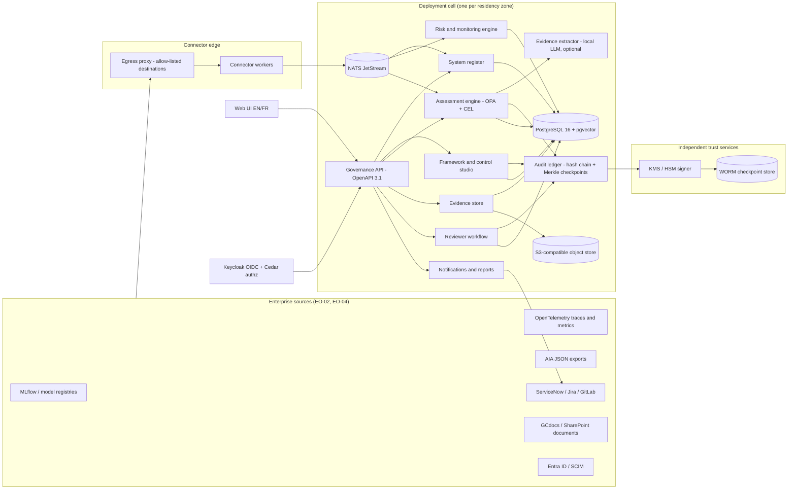

# AI Governance Platform — Build Blueprint (ISC SSC Challenge)

Author: Arpan Bom, Tri-Vision AI & Robotics Inc. (Brampton, Ontario)
Version: 1.0 (Nov 3, 2026). Status: design blueprint. No code exists yet.

## 0. How to use this document

- This is the single source of truth for building the platform. A builder should be able to read it top to bottom and build the whole system in the order given in section 17.
- Every design item points to requirement IDs from `requirements.md` (EO = essential outcome, AO = additional outcome, MC/PR = proposal questions, TRL = evidence rules, PF = program facts).
- Labels used:
  - **[Policy]** = what a law, policy, directive or standard actually says (with source).
  - **[Design]** = our own choice. It is not required by any policy.
  - **[Unverified]** = not confirmed from a primary source. Check it before relying on it.
  - **Status of our own claims:** *proposed* (designed only), *implemented* (built), *tested* (passed a dated test). Today everything in this document is *proposed*.
- Clean-room rule: public GitHub projects are listed for study only. No code, rule files, YAML libraries or text are copied from any of them. Public datasets are used only where the licence allows commercial use (section 20).
- Plain English is the house style for code comments, docs and UI text, in English and French.

## 1. Challenge summary and dates

| Item | Fact |
|---|---|
| Program | Innovative Solutions Canada (ISC), Phase 2 only |
| Challenge | Artificial Intelligence (AI) decision-making process visibility, traceability and compliance governance |
| Sponsor | Shared Services Canada (SSC) |
| Entry maturity | TRL 5 to 9 at bid time (TRL 4 or lower fails) |
| Funding | Up to $2,000,000 CAD (excluding taxes), up to 20 months, 1-2 contracts expected |
| Opened | Oct 30, 2026 |
| Questions deadline | Dec 12, 2026 (10 calendar days before close) to TPSGC.PASIC-APISC.PWGSC@tpsgc-pwgsc.gc.ca |
| Closes | Dec 22, 2026, 14:00 Eastern Time |
| Official source | CanadaBuys (wins if anything here differs) |
| Applicant | Tri-Vision AI & Robotics Inc., Brampton ON. All code, documents and IP by Arpan Bom. |

What the government wants, in one sentence: one platform that keeps a register of AI systems, checks each one against Canadian rules (and later NIST, ISO, EU), shows a clear five-state result with evidence and confidence for every control, lets humans review and override with a full audit trail, watches data/model/output risk, and runs on-prem or in Canadian cloud, in English and French, for many departments at once.

### 1.1 Honest maturity statement

- Today no prototype exists, so current TRL is **not proven**. To bid at TRL 5 we must build an integrated prototype and test it in a realistic simulated GoC environment, with dated results, before the evidence freeze (Dec 18, 2026).
- The schedule is tight: Nov 3 to Dec 22 is 49 days. Date gates (section 17):

| Gate | Date | Exit condition |
|---|---|---|
| G0 Scope and fixtures frozen | Nov 10 | Core profile, control manifest, fixture list and test thresholds signed off |
| G1 Integrated build | Nov 24 | All core services running together; end-to-end assessment of 1 system works |
| G2 First full test results | Dec 8 | All in-scope tests (essential + reduced tiers, section 18) run once; results stored with dates |
| G3 Fixes and retest | Dec 15 | Failed tests fixed and re-run |
| G4 Evidence freeze | Dec 18 | Evidence pack signed, tester names and titles recorded |
| Bid close | Dec 22, 14:00 ET | Submission (by the user, never by an automated agent) |

- If G1 slips past Nov 24, bid at the TRL the evidence supports, or do not bid. Never describe planned tests as completed.

## 2. Requirements in short

Full list with key words: `requirements.md`. Every component, table and test below names the IDs it serves.

- **Must (EO-01..EO-18):** continuous alignment and reassessment flags (EO-01); low-effort integration (EO-02); standards-based exchange of 15 information categories (EO-03); aggregation and sync (EO-04); open standards, no lock-in (EO-05); admin/support access control (EO-06); self-service residency/retention/access/deletion (EO-07); requirement→control traceability and non-conformities (EO-08); framework lifecycle and the 5 named GoC frameworks (EO-09); per-system criteria and NIST/ISO/EU extensibility (EO-10); human-readable findings with confidence (EO-11); assurance artefacts with RBAC provenance (EO-12); five outcomes (EO-13); reviewer validate/reject/modify/annotate with audit log (EO-14); data/model/output risk (EO-15); data quality baselines (EO-16); configurable metrics (EO-17); output monitoring (EO-18).
- **Should (AO-01..AO-04, 10 points only if all four):** on-prem/private/Canadian cloud; EN/FR everywhere; multi-tenant; reports, alerts and ticketing/chat integration.

## 3. Architecture overview

### 3.1 Principles [Design]

1. **Deterministic first, LLM second.** Rules decide outcomes. An LLM may only extract and summarize evidence; its output is a draft until a human approves it.
2. **Evidence or abstain.** Missing, stale or unauthorized mandatory evidence gives `unable_to_determine`, never a silent pass or fail.
3. **Everything versioned and replayable.** Frameworks, controls, rules, system metadata, evidence and decisions are bitemporal (valid time + record time).
4. **Open formats at every edge.** OpenAPI 3.1, OSCAL 1.2.3, CycloneDX, CloudEvents 1.0, OpenTelemetry, OpenLineage, SCIM 2.0, OIDC.
5. **One container set, any environment.** Same image digests on-prem, private cloud and Canadian cloud; only configuration changes.
6. **Small core, optional add-ons.** The TRL 5 prototype uses a core profile; heavy add-ons are switched on only when a department needs them.

### 3.2 Logical diagram



### 3.3 Deployment cells and residency [Design] (EO-07, AO-01, AO-03)

- A **cell** is one full copy of every service that holds tenant data: database, object store, queue, cache, search (if on), identity metadata, logs, backups and the signer client.
- A tenant (department) is bound to one cell on the server side. A user cannot change it with a setting. Moving a tenant to another residency zone is a controlled, audited migration.
- Inside a cell, tenants share services but are isolated in every layer (section 12.1).
- Example cells: `ca-onprem-ssc` (SSC data centre), `ca-central` (Canadian cloud region), `ca-private` (OpenShift private cloud).

## 4. Components

| # | Component | What it does | Main requirement IDs |
|---|---|---|---|
| C1 | Governance API | One OpenAPI 3.1 REST API for everything (UI uses the same API). Versioned `/api/v1`. | EO-02, EO-03, EO-05 |
| C2 | Identity and access | Keycloak (OIDC/SAML federation, SCIM in), Cedar policies for every authorization decision, just-in-time (JIT) support access with time limit and approval. | EO-06, EO-12, AO-03 |
| C3 | System register | AI system records in 15 categories (section 5.2); import from GC AI Register CSV; field-level source precedence; quarantine for conflicts. | EO-03, EO-04 |
| C4 | Connector framework | Pull and push connectors (section 10.3), each a small plug-in with a manifest, run through the egress proxy. Transactional outbox to NATS. | EO-02, EO-04 |
| C5 | Framework and control studio | Create, version, approve, replace and retire frameworks, controls, objectives and crosswalks; assign them to systems or groups. Policy-change watcher. | EO-01, EO-08, EO-09, EO-10 |
| C6 | Assessment engine | Evaluates each control for each system with OPA (Rego) and CEL; five-state result; precedence rules; explanation builder; certainty index. | EO-08, EO-11, EO-13 |
| C7 | Evidence extractor (optional) | Local LLM (vLLM) that finds and quotes passages in documents; output is always a draft with stored prompts and responses. | EO-08, EO-11 |
| C8 | AIA engine | Native bilingual AIA questionnaire and scoring with exact parity to the official tool (pinned version); import/export of official AIA JSON. | EO-03, EO-09 |
| C9 | Evidence store | Artefacts with hash, author, role at time of submission, validity window, lineage; files in object storage, metadata in Postgres. | EO-12 |
| C10 | Reviewer workflow | Queue of findings; validate / reject / modify / annotate; separation of duties; optimistic locking. | EO-14 |
| C11 | Risk and monitoring engine | Data quality, drift, fairness, output quality and safety metrics with baselines and thresholds; binding vs advisory breaches feed controls. | EO-15..EO-18 |
| C12 | Audit ledger | Append-only events, per-tenant hash chain, Merkle checkpoints signed by an independent signer, WORM copies. | EO-06, EO-12, EO-14 |
| C13 | Data policy service | Self-service residency (cell binding view), retention, legal hold, deletion with certificates. | EO-07 |
| C14 | Notifications and reports | Alerts, digests, EN/FR PDF/HTML reports, CloudEvents webhooks, ticket and chat adapters. | AO-04, AO-02 |
| C15 | Interop exporter/importer | OSCAL 1.2.3, CycloneDX ML-BOM, AIA JSON, CSV; five-state profile; capability negotiation. | EO-03, EO-05 |
| C16 | Web UI | Next.js app, EN/FR, WCAG 2.1 AA target, all workflows. | AO-02, EO-11, EO-14 |
| C17 | Observability | OpenTelemetry Collector, Prometheus metrics, structured logs, Jaeger traces (optional) for the platform itself. | EO-06, TRL-02 |

## 5. Data model

### 5.1 Storage rules [Design]

- PostgreSQL 16 is the system of record. Every tenant-owned table has `tenant_id` and Row-Level Security (RLS) with `FORCE ROW LEVEL SECURITY`. The app role is `NOBYPASSRLS`. Each request sets the tenant with `SET LOCAL app.tenant_id` inside its transaction.
- **Bitemporal tables:** versioned records carry `valid_from`, `valid_to` (when it is true in the world) and `recorded_at`, `superseded_at` (when we stored it). The app role has no UPDATE or DELETE grant on these tables. Changes go through one `SECURITY DEFINER` procedure per table that closes the old row and inserts the new one.
- **IDs:** UUIDv7 for all records. Human-readable keys (`SYS-02`, `CA-DADM-APP-C-03`) are separate unique columns.
- **Bilingual text:** every user-facing text field is stored as a pair `*_en`, `*_fr` (both columns, not a JSON blob), so reports can check parity.
- **Files** (documents, exports, model cards) live in the object store; Postgres keeps the URI, SHA-256, size and media type.

### 5.2 The 15 governance information categories (EO-03)

The notice lists these as examples (not a closed list). Each maps to a table group and to standard formats.

| # | Category | Main table(s) | Key fields (short) | Exchange format | Usual source |
|---|---|---|---|---|---|
| 1 | AI system metadata | `ai_system`, `ai_system_version` | system_key, name_en/fr, description_en/fr, capabilities, modality (tabular_ml, llm_rag, agentic, cv), components (BOM refs), data_sources, security_category, cell_id | GC AI Register CSV columns, CycloneDX ML-BOM, OSCAL SSP | Model registry, register import, intake form |
| 2 | Ownership | `system_party_role` | organization, business_owner, technical_custodian, risk_steward, approver_role, org_unit | OSCAL parties / responsible-parties | Identity provider (SCIM), CMDB |
| 3 | Intent | `system_intent` | intended_use_en/fr, out_of_scope_uses, admin_decision (bool), planned_production_use (bool), autonomy_level, user_notice_given | Model card considerations | Intake form |
| 4 | Deployment status | `system_lifecycle` | register_status (Conception, In development, Pilot, In production, Retired), environment_stage, status_date, first_production_date | GC AI Register status, OSCAL SSP status | Registry alias, CI/CD, Kubernetes webhook |
| 5 | Funding state | `system_funding` | funding_status, fiscal_year allocations, cost centre, project code, procurement vehicle | Internal JSON (no open standard found) | ERP/ITSM export or manual |
| 6 | Client information | `system_clients` | primary_users, impacted_groups (GBA Plus categories), involves_personal_info, PIB references, PIA reference, est_annual_decisions | GC AI Register PI fields | Intake + privacy office |
| 7 | System objectives | `system_objective` | objective_en/fr, KPI id, baseline, target, unit, window | Internal JSON | Charter + monitoring |
| 8 | Risk assessments | `risk_item`, `risk_item_version` | category (data, model, output, security, privacy, bias, supply_chain), likelihood, impact, inherent/residual score, status, due date | OSCAL assessment-results risks | Risk engine + steward |
| 9 | Algorithmic Impact Assessment | `aia_record` | schema_version (pinned), phase, answers (JSON), raw_score, mitigation_score, final_score, impact_level, publication_uri | Official AIA JSON export | AIA engine or import |
| 10 | Compliance findings | `finding`, `finding_version` | control_id, objective_id, outcome_state, lifecycle_state, certainty_index, explanation_en/fr, evidence refs, engine bundle digest | OSCAL assessment-results findings (five-state profile, section 10.2) | Assessment engine + reviewers |
| 11 | Audit evidence | `evidence_artefact` | title_en/fr, type, storage_uri, sha256, submitted_by, submitter_role_at_time, authorized (bool), collected_at, valid_until, lineage | OSCAL back-matter resources, W3C PROV-O | Connectors, uploads |
| 12 | Monitoring results | `observation` | metric_id, window, slice, sample size, value, baseline, threshold, severity, binding (bool) | OSCAL observations, OTel metrics, OpenLineage facets | Risk and monitoring engine |
| 13 | Approvals | `approval` | type (deployment authorization, exception, framework publish, …), required authority level, approver, approver role verified at action time, decision, conditions_en/fr, signed_at, expires_at | OSCAL attestations | Human sign-off |
| 14 | Decision records | `decision_record` | subject, actor, actor_role, action (validate, reject, modify, annotate, waive), before/after snapshot, rationale_en/fr | OSCAL props + POA&M | Reviewer workflow |
| 15 | Control requirements (playbooks) | `framework`, `framework_version`, `control`, `control_version`, `objective`, `crosswalk` | slug, semver, lifecycle, clause_ref, obligation_type, applicability_expr, evidence_specs, rule_ref, remediation_en/fr | OSCAL catalog, profile, mapping-collection | Framework studio |

The GC AI Register MVP CSV has 24 columns (15 attributes, 9 with EN/FR pairs) [Policy: open.canada.ca dataset fcbc0200-79ba-4fa4-94a6-00e32facea6b]. Its rows are incomplete by design (MVP); use them to test normalisation and abstention, not as truth.

### 5.3 Core tables (minimum set)

| Group | Tables |
|---|---|
| Tenancy | `tenant`, `cell`, `tenant_cell_binding`, `org_unit`, `system_group`, `system_group_member` |
| Identity | `principal` (synced from IdP), `role`, `role_assignment` (bitemporal), `jit_grant` |
| Register | `ai_system`, `ai_system_version`, category tables in 5.2, `source_record`, `field_provenance`, `quarantine_item` |
| Frameworks | `framework`, `framework_version`, `clause`, `control`, `control_version`, `objective`, `crosswalk`, `assignment` (framework version ↔ system or group, with criteria overrides) |
| Assessment | `assessment_run`, `finding`, `finding_version`, `finding_evidence_link`, `explanation`, `llm_call` (prompt, response, model id, digest) |
| Evidence | `evidence_artefact`, `evidence_version`, `evidence_spec`, `legal_hold`, `retention_policy`, `deletion_request`, `deletion_certificate` |
| Review | `review_task`, `decision_record`, `exception`, `remediation_action` |
| Risk | `metric_definition`, `metric_version`, `baseline`, `threshold`, `observation`, `risk_item`, `data_quality_issue` |
| Change | `policy_source`, `policy_snapshot`, `policy_diff`, `impact_set`, `reassessment_flag` |
| Ledger | `audit_event`, `audit_pii` (side table, referenced by commitment), `merkle_checkpoint`, `outbox`, `processed_event_ids` |
| Integration | `connector_instance`, `connector_run`, `webhook_subscription`, `notification`, `ticket_link` |

### 5.4 Source precedence (EO-04) [Design]

- Each field has an authoritative source tier, for example: funding_status → ERP (tier 1) over manual (tier 2); model_version → registry (tier 1); approval_status → ITSM or the platform's own approval record (tier 1). A lower tier never overwrites a higher tier.
- Out-of-order events are placed by their own event time in valid time; they never overwrite a newer fact.
- Clock skew over 300 seconds, or a conflict between two sources of the same tier, goes to `quarantine_item` for a human. Nothing is silently merged.
- Missing non-technical fields (for example funding) are marked `NEEDS_INTAKE`, never defaulted.

## 6. Rule and control engine (EO-08, EO-11, EO-13)

### 6.1 Three engines, three jobs [Design]

| Engine | Used only for | Why |
|---|---|---|
| **OPA / Rego** (Apache-2.0) | Compliance evaluation of each control objective and the five-state result | Mature, testable (`opa test`), bundles can be signed and pinned by digest |
| **CEL** (Apache-2.0 spec) | Small bounded expressions: applicability predicates and custom metric formulas written by users | Side-effect free, cheap, safe for user input |
| **Cedar** (Apache-2.0) | Authorization only (who may do what on which record) | Clear policy language, analysable |

- JsonLogic and any other rule language are not used.
- **CEL limits:** AST depth ≤ 10, collection size ≤ 1,000, cost budget ≤ 1,000, timeout 25 ms. Any CEL error → `unable_to_determine` with reason `EVAL_ERROR`.
- One versioned **evaluation contract** (JSON Schema) defines typed inputs, error codes and outputs for every control. OPA bundles and CEL expressions are stored with their SHA-256 digest; each finding records the digest it used.
- **Python bindings for Cedar and CEL [Unverified]:** confirm licence and maintenance of the chosen Python packages (for example a Cedar Python binding and a CEL Python implementation) at G0. If none is acceptable, run Cedar via its official Rust CLI/library in a small sidecar, and run CEL through a conformance-tested library only.

### 6.2 Outcome states (EO-13)

`outcome_state` has exactly five values: `met`, `partially_met`, `not_met`, `not_applicable`, `unable_to_determine`.

**Precedence (first rule that matches wins) [Design]:**

1. Applicability predicate is false → `not_applicable`. (Unknown applicability is not false; see rule 3.)
2. A verified failure of a **critical gate** objective → `not_met`, even if other evidence is missing.
3. Any mandatory evidence is missing, stale (past `valid_until`), from an unauthorized submitter, or any evaluation error, or applicability is unknown → `unable_to_determine`.
4. Some objectives pass and some non-critical objectives fail → `partially_met`.
5. All applicable objectives pass → `met`.

- A control with zero applicable objectives is `not_applicable` with reason `NO_APPLICABLE_OBJECTIVES` (declared explicitly, not by accident).
- Each finding stores a machine reason code (for example `CRITICAL_GATE_FAILED`, `EVIDENCE_STALE`, `SUBMITTER_UNAUTHORIZED`, `APPLICABILITY_UNKNOWN`) next to the state.
- Monitoring breaches change a compliance outcome only when the metric threshold is marked **binding** for that control. Advisory thresholds raise alerts and tasks but never downgrade a legal outcome by themselves.

### 6.3 Finding lifecycle and reviewer actions (EO-14)

Two separate fields:

- `lifecycle_state`: `DRAFT_AUTO` (rules only) → `DRAFT_LLM` (used LLM-extracted evidence) → `APPROVED_HUMAN` → `EFFECTIVE` → `SUPERSEDED`.
- `review_action` (stored in `decision_record`): `validate`, `reject`, `modify`, `annotate`.

Rules:
- `DRAFT_LLM` can never become `EFFECTIVE` without a human `validate` or `modify`.
- `reject` sends the finding back to draft for revision with a reason; it never enters an approved state.
- `modify` creates a new finding version with the reviewer's outcome, rationale (EN or FR, translated later) and the before/after snapshot.
- `annotate` adds a note and never changes the outcome.
- Separation of duties: the system owner (or anyone in the owner's party role) cannot validate or modify findings on their own system.
- Optimistic locking: every action carries the version it saw; a stale action gets HTTP 409.
- Every action writes an `audit_event` (section 8.4).

### 6.4 Human-readable explanation (EO-11)

Every finding has an explanation in EN and FR generated from a fixed template, never free text from an LLM alone:

> **Requirement:** DADM Appendix C – Peer review (Level III). **Control:** CA-DADM-APP-C-03 v1.2.0. **Result:** Not met. **Why:** The system is Impact Level III (AIA final score 85 of 167). Level III needs a review by at least one qualified expert of the system, the AIA and supporting documents. No peer-review artefact submitted by an authorized role was found. **Evidence used:** AIA record AIA-0007 (sha256 3f…), evidence search over 14 artefacts. **Certainty index:** 0.91 (high; deterministic rule, evidence complete). **What to do:** Upload a peer-review report signed by a reviewer with the "Peer Reviewer" role.

Fields: requirement and clause (with source URL and version), control id and version, outcome, reason code, objectives with pass/fail, evidence list (id, hash, quote and location if LLM-extracted), certainty index with its band, remediation text, engine bundle digest, timestamp.

### 6.5 Certainty index (EO-11) [Design]

- The notice allows "a confidence score or a certainty measure". We show a **certainty index** from 0.00 to 1.00 with bands (high ≥ 0.80, medium 0.50–0.79, low < 0.50). It is labelled as an index, **not a probability**, until calibration is proven.
- Inputs: evidence completeness (share of required evidence present), freshness, submitter authorization, whether the result is purely deterministic or used LLM extraction, the LLM extraction agreement across passes, and metric sample size / confidence interval width.
- One versioned **calibrator** turns these inputs into the displayed score. Version 0 is a documented weighted rule. After enough adjudicated findings exist (independent reviewers, split by document family, EN and FR together), fit version 1 and report Expected Calibration Error (ECE) and Brier score for the defined event "the final reviewed outcome equals the automated outcome". Only then may it be called calibrated.
- Conformal prediction may be shown as an advisory set of plausible outcomes. It gives average (marginal) coverage only, not a guarantee for each finding.

### 6.6 LLM evidence extractor (optional, C7) [Design]

- Runs locally (vLLM) with an Apache-2.0 model; no data leaves the cell.
- Task: given a control objective and documents, return quoted passages with location. Every quote is checked by exact substring match against the stored document; a failing quote is dropped.
- Exact substring is not enough: the extractor also labels the quote as supports / contradicts / irrelevant, and a quote marked irrelevant or negated never supports `met`. Test T-24 checks 100 exact-but-irrelevant quotes.
- Prompt, model id, model file digest, parameters and full response are stored in `llm_call`. Replays use the **stored** responses. Exact regeneration from the model is not promised.
- Documents are treated as data, never as instructions (prompt-injection defence): system prompt pinned, documents wrapped and escaped, output must match a JSON schema, and any finding that used the LLM stays `DRAFT_LLM` until a human acts.
- Model choices [Unverified sizing]: Mistral-Small-24B-Instruct-2501 (Apache-2.0) as main; Qwen2.5-14B-Instruct or granite-3.3-8b-instruct as smaller options. Measure peak GPU memory in a pilot; a 32k context at batch 4 needs roughly 20 GiB of KV cache in BF16 alone, on top of weights.
- The platform must work fully without the LLM. With the LLM off, document-based objectives without structured evidence become `unable_to_determine` and are routed to a human.

## 7. Frameworks, controls and reassessment (EO-01, EO-08, EO-09, EO-10)

### 7.1 Framework model

- `framework` (slug, owner, obligation_type) → `framework_version` (semver, effective_from, effective_to, lifecycle: `draft`, `approved`, `active`, `deprecated`, `retired`, source snapshot hashes EN/FR) → `clause` (clause_ref, text_en, text_fr) → `control` / `control_version` (one testable obligation) → `objective` (one checkable test, critical gate yes/no, evidence specs, rule ref).
- **Obligation type is always explicit:** `legislation`, `binding_policy` (policy, directive, standard), `adopted_security_profile`, `guidance`, `strategy_commitment`, `voluntary`, `local_rule`. Reports group results by obligation type so guidance is never shown as law.
- **Assignment:** a framework version is assigned to a system or a group (by AIA level, modality, department, risk profile). Assignments can override thresholds and criteria per group, with the override recorded and approved (EO-10).
- **Crosswalks:** `crosswalk` rows link controls across frameworks (relation: equal, subset, superset, intersects) with a reviewer and source. Evidence can be reused only when the relation and the evidence spec both allow it; weaker evidence is never treated as equal.
- **Import/export:** OSCAL 1.2.3 catalog, profile and mapping-collection. Authors can also edit controls as YAML/Markdown in the studio, which compiles to OSCAL and is validated against the official JSON Schemas.

### 7.2 Lifecycle operations (EO-09, EO-10)

| Operation | What happens | Reassessment trigger |
|---|---|---|
| Add framework / version | Draft → policy steward review → approve (two people for binding types) → active on its effective date | All assigned systems get `reassessment_required` for the new controls |
| Change control | New control version; diff stored | Systems where the control applies, or whose applicability could flip |
| Replace | New version supersedes old on a date; old version kept for history | All systems on the old version |
| Retire | Version or control set to retired on a date; findings kept, marked historical | Systems lose the obligation; affected open tasks closed with reason |
| Roll back | Re-activate a previous version (audited) | Same as change |

Other reassessment triggers: system metadata change in a field used by an applicability predicate; new or expired evidence; AIA re-scored with a different level; binding monitoring breach; approval expiry; scheduled review date.

### 7.3 Policy change watcher and impact analysis (EO-01)

1. **Watch** canonical source pages (TBS policy suite pages, open.canada.ca records via the CKAN API, the official AIA GitHub repo, EUR-Lex, NIST). The TBS policy RSS/notice feed URLs tested in research returned 404, so the watcher polls the canonical pages on a schedule and keeps snapshots. Offline deployments accept a signed policy bundle uploaded by a steward.
2. **Snapshot** raw EN and FR pages with SHA-256; normalize to a clause tree.
3. **Diff** against the active version: added, changed, removed clauses. Formatting-only changes are detected by comparing normalized text and are shown but never activate anything.
4. **Human gate:** a draft amendment with EN/FR redlines and suggested control changes goes to the policy steward. Nothing becomes active without approval.
5. **Impact set:** using clause → control → assignment → system links and the applicability predicates, compute affected systems and controls. Show counts, list and reason for each.
6. **Flag and re-run:** set `reassessment_required` with the reason, emit a CloudEvent (`ca.gc.aigov.policy.amendment.impact` — our own type name), open tasks, and re-evaluate only the affected controls. History under the old version stays queryable.

Measured targets (proposed): detect 10/10 substantive changes in a captured set, activate 0/10 formatting-only changes, 0 unapproved activations, impact computation p95 ≤ 5 s for 500 systems.

### 7.4 Starter framework packs (EO-09)

The notice requires at least these five. Each pack is built from the official EN and FR text, pinned by date and hash, and every control row carries clause, obligation type and source URL. An independent fact check of the draft research catalogue found 54 of 55 draft controls needed fixes; the rules below are the result and must be followed when writing the packs.

| Pack | Source (canonical) | Obligation type | Notes for encoding |
|---|---|---|---|
| Directive on Automated Decision-Making (DADM) | tbs-sct.canada.ca/pol/doc-eng.aspx?id=32592 | binding_policy | Section 6 clauses 6.1.1–6.5.2 (including 6.2.7 and 6.3.3) and Appendix C (7 rows). Details in 7.5. |
| Algorithmic Impact Assessment (AIA) | github.com/canada-ca/aia-eia-js (MIT), plus the AIA guidance page | binding (via DADM 6.1) | Exact scoring parity with a pinned revision. Details in 7.6. |
| Policy on Service and Digital (PSD) | tbs-sct.canada.ca/pol/doc-eng.aspx?id=32603 | binding_policy | Application is in section 6 (not 8). Automated decision systems are 4.1.28 and its subclauses. 4.1.24 is about documenting decisions and decision-making. 4.1.26 covers accessibility, languages, privacy, environment and security by design. Open release is 4.1.22. Re-read every clause number against the current text; the research had many wrong mappings. |
| Directive on Service and Digital (DSD) (supporting) | tbs-sct.canada.ca/pol/doc-eng.aspx?id=32601 | binding_policy | Current text modified Aug 29, 2025. 4.3.24: Canadian facilities (or departmental premises abroad) must be identified and evaluated as a principal delivery option — do not invent exceptions. |
| Government of Canada AI Strategy (2025-2027) | canada.ca … responsible-use-ai … gc-ai-strategy-priority-areas | strategy_commitment | Launched March 4, 2025. Four priorities: 1 Central AI capacity; 2 Policy, legislation and governance; 3 Talent and training; 4 Engagement, transparency and value to Canadians. The AI Register sits under priority 4. Controls here are mostly evidence-of-alignment, not pass/fail law. |
| Guiding principles for the use of AI (AI ethics and responsibilities) | canada.ca … responsible-use-ai/ai-ethics-responsibilities/principles.html | guidance | Encode each principle as its own control with its current number and wording taken from the page at build time [Unverified: research numbering was wrong; re-read]. |
| Guide on the use of generative AI (optional profile) | canada.ca … responsible-use-ai/generative-ai/guide-use-generative-ai.html | guidance | Opt-in profile; recommendations are not binding by default. |

Extension packs to prove EO-10 (encouraged): NIST AI RMF 1.0 (and the Generative AI Profile NIST AI 600-1), ISO/IEC 42001:2023 (**identifiers and short own-words titles only**; the standard text is copyrighted and the customer must bring their own licence), EU AI Act (Regulation (EU) 2024/1689, from EUR-Lex).

### 7.5 DADM encoding rules [Policy + Design]

[Policy, DADM id=32592, as summarized in verified research]
- Took effect April 1, 2019, with compliance by April 1, 2020. Applies to systems developed or procured after April 1, 2020. The 2025 amendments had a transition to June 24, 2026, which has now passed. Agents of Parliament have specific carve-outs (8.3.3–8.3.5).
- Scope 5.1; exclusions in 5.2 include research and test environments; national security systems are excluded.

Encoding rules [Design, from the second fact check]:
1. Use separate fields for **planned production use**, **current lifecycle stage** and **client impact**. Obligations that must be met *before* production (AIA 6.1.1, testing 6.3.1, legal consultation from concept stage 6.3.12, peer review 6.3.7, approval 6.3.14) apply as soon as production use is planned. A test-environment exclusion never switches off release-preparation duties for a system that is headed to production.
2. Missing or invalid impact level → `unable_to_determine` for level-dependent controls. It never turns them off.
3. Evidence mechanics (valid JSON, a signature, a URL, a scan) can support a finding but never prove legal compliance on their own. Controls that need judgment (meaningful explanation, effective recourse, Charter/CHRA consistency in 6.3.3) always need a human reviewer for `met`.
4. Approval authority is checked against the approver's role **at the time of the action**, not today's role.

Appendix C (7 rows) [Policy]:

| Row | Level I | Level II | Level III | Level IV |
|---|---|---|---|---|
| Notice | Plain-language notice on all channels in use | Same as I | Notice plus link to the explanation | Same as III |
| Explanation | Published general explanation of how the system works | Plus an individual explanation when a decision results in denial or regulatory action ("where appropriate" qualifiers kept) | Same as II | Same as II |
| Peer review | None | At least 1 qualified expert reviews the system, AIA and supporting documents; publish review or summary | Same as II | At least 2 experts |
| GBA Plus | None | Required | Required | Required |
| Training | Role-based training | Same as I | Recurring training for all relevant staff (development, use, management) | Same as III |
| Human involvement | System may decide without direct human involvement (humans do QA and can intervene) | Same as I | Final decision made by a human | Same as III |
| Approval to operate | ADM responsible for the program | Same as I | Deputy head | Treasury Board (or head of an Agent of Parliament, 8.3.5) |

Do not add a "contingency" row; it is not in Appendix C.

### 7.6 AIA scoring parity [Policy, from the official code]

Pinned to `canada-ca/aia-eia-js` commit `b625733` (record the full commit hash and file hashes at G0):
- Raw risk maximum 167 (70 risk questions in `src/survey-enfr.json`). Mitigation maximum 154 across both branches; effective denominator 77.
- If mitigation score ≥ 62 (that is 80% of 77, rounded up as the code compares), final = round(0.85 × raw); otherwise final = raw.
- Impact levels by final score: I 0–41, II 42–83, III 84–125, IV 126–167.
- The official prose mentions a different maximum (169) in places. Keep it as a documented note; the code is the parity target.
- Test branching, hidden answers being cleared, checkbox scoring, incomplete assessments and rounding at every boundary against the official scorer run on the same inputs. Example: raw 100 with mitigation ≥ 62 → 85 → Level III; raw 82 with no deduction → Level II.
- Import the published AIA JSON files (IRCC AAST, CBSA CRES) as fixtures.

## 8. Evidence, provenance, review and audit (EO-12, EO-14, EO-06)

### 8.1 Evidence store (EO-12)

- Artefact classes (all eight named in the notice): control mappings, assessment records, evidence references, approvals, exceptions, attestations, remediation actions, audit histories.
- Each artefact version stores: SHA-256 of the content, storage URI, media type, title EN/FR, `submitted_by`, **`submitter_role_at_time`** (looked up from the bitemporal role table at submission), `authorized_submitter` (true/false against the evidence spec for that class), `collected_at`, `valid_until`, lineage links (W3C PROV-O style: generated by, attributed to, derived from).
- An unauthorized submission is accepted only as a quarantined record flagged `authorized_submitter = false`; it can never satisfy a mandatory evidence spec.
- Signatures are required only where the control's evidence spec says so (for example approvals). Unsigned evidence is not automatically rejected elsewhere.
- Files are scanned (type check, size cap 50 MB default, malware scan hook) before storage.

### 8.2 Roles (RBAC, evaluated by Cedar) [Design]

| Role | Can do |
|---|---|
| Platform operator (vendor or SSC ops) | Run the platform; **no access to tenant data** by default. Tenant data access only through a JIT grant approved by the tenant admin, time-boxed (default 4 h), fully logged. |
| Tenant admin | Manage users, roles, data policies, connectors, cell view for their tenant |
| Policy steward | Draft and propose framework versions; approve when a second steward has reviewed |
| System owner | Register and update their systems, upload evidence; cannot validate their own findings |
| Assessor | Run assessments, draft findings |
| Oversight reviewer | Validate, reject, modify, annotate findings (not on systems they own) |
| Approver | Sign approvals at their authority level (ADM, deputy head, etc. recorded as attribute) |
| Auditor (e.g. ATIP, internal audit) | Read-only access to findings, evidence metadata and the audit ledger |
| Read-only viewer | Read dashboards and reports |

All decisions are attribute-based too: tenant, org unit, system group, classification, and the user's role at the time.

### 8.3 Reviewer workflow (EO-14)

- Queue sorted by risk (impact level, not_met first, low certainty first, due date).
- Each task shows the finding, explanation, evidence with quotes highlighted, history, and the four actions.
- `modify` needs a rationale; `reject` needs a reason code; both are mandatory text fields.
- Bulk validate is allowed only for `DRAFT_AUTO` findings with certainty ≥ 0.80 and is logged per finding.
- Exceptions (waivers) need an approver, an expiry date and compensating controls; an expired exception triggers reassessment.

### 8.4 Audit ledger (EO-06, EO-12, EO-14)

- Every state change and every privileged read (admin, support, export) writes an `audit_event` in the same database transaction as the change.
- Per-tenant **hash chain**: each event stores `prev_hash` and `event_hash` over a canonical JSON (RFC 8785) form.
- **Merkle checkpoints** (RFC 6962 style): every 60 seconds or 1,000 events, a signed tree head is produced by an **independently administered signer** (KMS/HSM key that platform admins cannot use) and copied to **WORM object storage** (object lock). Leaf manifests are stored separately from the database.
- Personal information in events is kept in a side table (`audit_pii`) referenced by a hash commitment, so it can be deleted lawfully while the chain still verifies.
- What this proves: tampering, deletion or truncation after a checkpoint is detected and located. What it does not prove: events changed before they were checkpointed (disclosed exposure window ≤ 60 s), or that the content was true.
- A verifier CLI and API check the chain, the checkpoints and the WORM copies, and report exact row ranges that fail.

### 8.5 Reproducing a past assessment

Each finding pins six inputs: control/framework version, system metadata version, evidence manifest (ids + hashes), engine bundle digest (OPA + CEL), LLM provenance (stored request/response, model digest), and the reviewer decision. "Show me the compliance of SYS-02 as known on date X" is a bitemporal query. Replays use stored LLM responses. If evidence was lawfully deleted, the replay reports "unavailable after authorized deletion" with the tombstone, instead of pretending.

## 9. Data, model and output risk (EO-15, EO-16, EO-17, EO-18)

### 9.1 Metric catalogue (starter, all configurable per system)

| Area | Metric (default) | Default threshold (example, tenant-configurable) | Library |
|---|---|---|---|
| Data quality (EO-16) | Completeness (missing rate per column) | warn > 2%, breach > 5% | Evidently / own SQL |
| Data quality | Schema conformance (types, allowed values) | breach on any violation of a required column | Great Expectations-style suite (own) |
| Data drift | Population Stability Index per feature | warn > 0.10, breach > 0.25 | Evidently / SciPy |
| Data drift | Kolmogorov–Smirnov p-value (with false discovery rate control) | breach < 0.01 after FDR | SciPy |
| Personal info | PII detection rate in inputs/outputs (EN/FR patterns incl. SIN, phone, email) | breach > 0 in outputs | Presidio + own FR recognizers |
| Model performance (EO-17) | Accuracy / F1 / AUC on labelled windows | breach if drop > 5 points vs baseline | scikit-learn |
| Calibration | ECE of model scores | warn > 0.05 | own |
| Fairness (EO-18) | Demographic parity difference; equal opportunity difference; disparate impact ratio (by group and intersections) | warn DI < 0.80 (scenario parameter, **not a legal test**) | Fairlearn MetricFrame |
| Output quality (LLM) | Faithfulness / answer relevance on a reference set | warn < 0.80 | Ragas-style metrics (own implementation or library) |
| Consistency | EN vs FR answer agreement on paired prompts | warn < 0.90 | own |
| Safety | Attack success rate on jailbreak sets; benign over-refusal rate | breach ASR > 5%; warn over-refusal > 10% | garak / promptfoo / inspect_ai harness, JBB/HarmBench data |
| Operations | Latency p95, error rate | per SLO | Prometheus |

- Every metric has a versioned definition (inputs, unit, window, aggregation), an approved **baseline** (dataset version + date + approver) and thresholds marked **binding** (linked to a control objective) or **advisory**.
- Custom metrics: tier 1 = CEL formula over existing observations (no code); tier 2 = sandboxed plug-in (separate container, no network, read-only input, CPU/memory/time limits).
- Every breach creates a `data_quality_issue` or `risk_item` with the dataset version, system, window and link to the affected control. Issues are tracked to closure (EO-16 "traceable record").
- Results are written as `observation` rows and exported as OSCAL observations.

### 9.2 Risk register (EO-15)

- Risk categories: data, model, output, security, privacy, bias, supply chain.
- Inherent and residual likelihood × impact (1–5 each), owner, mitigations (links to controls), status (open, mitigated, accepted, transferred), next review date.
- Monitoring breaches can raise or re-score a risk automatically as a draft; acceptance needs a human with the right role.

## 10. API, interoperability and connectors (EO-02, EO-03, EO-04, EO-05)

### 10.1 OpenAPI 3.1 outline (`/api/v1`)

All endpoints: OIDC bearer token, tenant from the token (never from the URL alone), `Accept-Language: en-CA | fr-CA`, cursor pagination, `ETag`/`If-Match` for updates, RFC 9457 problem+json errors, idempotency key header on POST.

| Area | Endpoints (main) |
|---|---|
| Systems | `GET/POST /systems`, `GET/PATCH /systems/{id}`, `GET /systems/{id}/history?as_of=`, `POST /systems/import` (GC AI Register CSV, CycloneDX), `GET /systems/{id}/categories/{category}` |
| Groups | `GET/POST /groups`, `PUT /groups/{id}/members` |
| Frameworks | `GET/POST /frameworks`, `POST /frameworks/{id}/versions`, `POST /framework-versions/{id}:submit`, `:approve`, `:activate`, `:retire`, `:rollback`, `GET /framework-versions/{id}/diff?against=` |
| Controls | `GET /framework-versions/{id}/controls`, `POST /controls/{id}/versions`, `GET/POST /crosswalks` |
| Assignments | `GET/POST /assignments` (framework version ↔ system/group, overrides) |
| Policy watch | `GET /policy-sources`, `GET /policy-diffs`, `POST /policy-diffs/{id}:promote` (creates draft version), `GET /impact-sets/{id}` |
| Assessments | `POST /assessments` (202 + job id), `GET /assessments/{id}`, `GET /systems/{id}/findings?state=&as_of=` |
| Findings | `GET /findings/{id}`, `GET /findings/{id}/explanation?lang=`, `POST /findings/{id}/actions` (validate/reject/modify/annotate) |
| AIA | `GET /aia/schema`, `POST /systems/{id}/aia` , `POST /aia:score`, `POST /aia:import`, `GET /aia/{id}/export` |
| Evidence | `POST /evidence` (multipart or presigned upload), `GET /evidence/{id}`, `GET /evidence/{id}/versions`, `POST /evidence/{id}/links` |
| Approvals / exceptions | `POST /approvals`, `POST /exceptions`, `GET /approvals?system=` |
| Risk and monitoring | `GET/POST /metrics`, `POST /metrics/{id}/versions`, `GET/POST /baselines`, `POST /observations` (batch), `POST /otlp/v1/metrics` (OTLP ingest via collector), `GET /risks`, `GET /data-quality-issues` |
| Data policy | `GET /data-policy`, `PUT /data-policy/retention`, `POST /legal-holds`, `POST /deletion-requests`, `GET /deletion-certificates/{id}` |
| Audit | `GET /audit/events`, `GET /audit/checkpoints`, `POST /audit:verify` |
| Interop | `GET /export/oscal/{type}` (catalog, profile, ssp, assessment-results, poam), `POST /import/oscal`, `GET /export/cyclonedx/{system}`, `GET /capabilities` |
| Integration | `GET/POST /connectors`, `POST /connectors/{id}:run`, `GET/POST /webhooks`, `GET /notifications` |
| Reports | `POST /reports` (type, scope, language, format PDF/HTML/CSV), `GET /reports/{id}` |
| Admin | `GET/POST /users` (SCIM 2.0 at `/scim/v2`), `POST /jit-grants`, `GET /health`, `GET /metrics` (Prometheus, internal) |

Event contract: CloudEvents 1.0 JSON on NATS subjects `tenant.<id>.<domain>.<event>` and on outbound webhooks (HMAC-signed). AsyncAPI document published next to the OpenAPI file.

### 10.2 OSCAL five-state profile [Design]

OSCAL 1.2.3 findings have `target.status.state` = satisfied / not-satisfied and an optional `reason`. Our profile (namespace `urn:trivision:oscal:ns:goc-ai-gov`, our own) adds a prop `outcome-state` with the exact value and maps:

| Our state | status.state | reason | Extra |
|---|---|---|---|
| met | satisfied | pass | |
| partially met | not-satisfied | other | prop outcome-state=partially-met |
| not met | not-satisfied | fail | |
| not applicable | satisfied | other | prop outcome-state=not-applicable; SSP implementation-status not-applicable |
| unable to determine | not-satisfied | other | prop outcome-state=unable-to-determine |

- Consumers that only read `status.state` would count N/A as a pass. So: our reports exclude N/A from pass totals; exports carry a `lossy-for-state-only-consumers` note; `GET /capabilities` lets a partner tool say whether it understands the profile.
- Validate every export against the official NIST OSCAL 1.2.3 JSON Schemas, plus our own referential checks (every UUID reference resolves).
- CycloneDX: pick **1.6** as the baseline for ML-BOM export (1.7 exists; add an adapter later).
- Round-trip testing must include an importer we did not write (for example the open-source compliance-trestle library, used as a test tool only).

### 10.3 Connectors (EO-02, EO-04)

| Connector | Direction | Protocol | Brings in |
|---|---|---|---|
| GC AI Register CSV / CKAN | pull | HTTPS CKAN API, CSV | Register entries (category 1–7) |
| MLflow model registry | pull + webhook | REST | Models, versions, aliases, metrics, artefacts |
| Kubeflow model registry / KServe | pull | REST / Kubernetes API | Deployed versions and status |
| OpenTelemetry | push | OTLP via Collector | Runtime metrics, GenAI traces |
| OpenLineage | push | HTTP | Dataset/job lineage, data quality facets |
| AIA tool JSON | upload / pull | file / GitHub | AIA records |
| SharePoint / GCdocs | pull | Microsoft Graph / CMIS-REST [Unverified per department] | Documents as evidence |
| ServiceNow / Jira / GitLab | both | REST + webhooks | Tickets, approvals, CMDB records |
| Teams / Slack / Mattermost / email | out | webhooks / SMTP | Alerts, digests |
| Identity provider | pull | SCIM 2.0, OIDC | Users, groups |
| Generic | both | CSV, JSON, OSCAL, CloudEvents webhook | Anything else |

- Each connector is a plug-in with a manifest: name, version, scopes, field mapping to the 15 categories, source tier per field, schedule, and the exact network destinations it needs.
- **Low effort target:** a declarative YAML mapping; no code to add a new source of a known type; setup ≤ 15 minutes for a simulator source (measured in T-02). Real enterprise systems are reported separately from simulators.
- **Delivery:** transactional outbox in Postgres → NATS JetStream (deduplicated with a message id) → consumers record `processed_event_ids` (at-least-once delivery, idempotent effects). Retries with backoff, max 7 deliveries, then a dead-letter queue with an alert.
- **Egress proxy (SSRF defence):** connectors can only reach destinations listed in their approved profile (FQDN, port, CIDR, mTLS if needed). DNS is resolved once and the socket pinned; redirects are refused; IPv6 and odd address encodings are covered; platform admin and storage endpoints are always blocked.

## 11. Reports, alerts and integrations (AO-04)

- Alerts: non-conformity found, reassessment required, evidence expiring (30/7/1 days), approval expiring, binding breach, quarantine item, JIT grant used.
- Channels: in-app, email, Teams/Slack/Mattermost webhooks, tickets in ServiceNow/Jira/GitLab with two-way status sync (ticket closed → remediation action closed, after evidence check).
- Duplicate suppression: one open ticket per (system, control, reason); repeated alerts update it.
- Reports (EN and FR, PDF and HTML, CSV data): system compliance dossier, portfolio status by department, framework coverage, impact report for a policy change, AIA summary, audit extract. Every report shows the as-of time, framework versions, and that N/A is excluded from pass rates.

## 12. Security, multi-tenancy, residency and data handling (AO-03, EO-07, AO-01)

### 12.1 Tenancy and cells

- A **cell** is one complete deployment of every service that touches tenant data (API, workers, database, object store, NATS, caches, search if used, logs, backups, keys) in one jurisdiction and security zone.
- Each tenant is bound to one cell on the server side. Moving a tenant is a controlled migration (export, verify hashes, import, cut over, crypto-shred old copy), never a setting toggle.
- Inside a cell, tenants are separated at every layer:

| Layer | Isolation |
|---|---|
| PostgreSQL | Row-level security with `FORCE ROW LEVEL SECURITY`; app role is `NOBYPASSRLS` and not the table owner; tenant id set with `SET LOCAL` inside each transaction; tested through PgBouncer transaction pooling (which does not reset session state) |
| pgvector | Partitioned by tenant; vector queries always carry the tenant filter; report recall@10 against exact search (target ≥ 0.95), never "full recall" |
| Object store | Bucket (or prefix + policy) and KMS key per tenant |
| NATS | Accounts or subject permissions per tenant |
| Cache (if used) | Valkey ACL per tenant key prefix |
| Search (if used) | Index per tenant |
| Audit | Partition and hash chain per tenant |
| Exports | Redaction gate and two-person sign-off for cross-tenant or bulk exports |

- Noisy-neighbour limits: per-tenant rate limits, job quotas and database statement timeouts.

### 12.2 Data policies (EO-07)

- Per tenant: residency cell, retention per artefact class, legal holds, deletion workflow, export controls, classification ceiling (for example Protected B), and the **security profile** in force (labels alone never decide controls).
- **Deletion precedence:** legal hold blocks everything → statutory retention floor → configured retention → delete.
  - Retention floor example [Policy]: Privacy Regulations SOR/83-508 s.4(1)(a) — personal information used for an administrative purpose is kept at least two years after its last use for that purpose (calendar years; exceptions for consent, and other cases in the regulation, kept as configurable reasons). Log retention baseline from the GC event logging guidance §1.5.2 (cloud PBMM: 3 months online, 6 months in storage, 2 years for incident-related logs) [Policy, re-verify at G0].
- **How deletion works:** deletable payloads are encrypted per record or per tenant with their own data key before storage. Deletion = delete the content + destroy the key + write a tombstone with the hash. Backups expire on their own schedule; the certificate says so.
- **Deletion certificate:** first `pending` (key scheduled for deletion in KMS — cloud KMS services enforce a waiting period), then `final` once the provider confirms destruction and backups have rotated. Never claim final erasure early.

### 12.3 Application security

- Identity: Keycloak (OIDC/SAML) or the department IdP; MFA required for admin, approver and steward roles; SCIM for users.
- Authorization: Cedar policies, deny by default, tested with a policy test suite.
- Encryption: TLS 1.2+ (prefer 1.3) inside and outside; disks and buckets encrypted with KMS keys; FIPS 140-validated crypto modules where the department requires it [Unverified per target platform].
- Secrets: cloud KMS / Kubernetes secrets with external KMS encryption; no BSL-licensed secret manager in the product.
- Supply chain: SBOM (CycloneDX) for code, containers, OS packages, model weights and datasets; signed images (cosign); pinned digests; licence gate.
- Verification target: OWASP ASVS 4.0.3 Level 2 mapping (each requirement marked pass / fail / not applicable with evidence) and the ITSG-33 / CCCS Medium cloud profile control families as a **design mapping**, not a certification claim.
- Logging: security events to the tenant audit ledger and to the department SIEM via syslog/OTLP.

## 13. English and French (AO-02)

- Every user-facing string comes from i18next resource files with keys; a CI check fails on missing keys in either language and on hard-coded strings.
- Domain content has paired fields (`title_en`, `title_fr`) with a translation status (`source`, `machine_draft`, `human_verified`). Reports never show a machine draft as official text without a label.
- Framework text is loaded from the official EN and FR versions of each instrument; we never translate legal text ourselves.
- Terminology: a glossary seeded from TERMIUM Plus open data (licence allows reuse under the Open Government Licence – Canada) [verify attribution wording at G0].
- Language from user profile, then `Accept-Language`; URLs are language-neutral; dates, numbers and sorting follow `en-CA` / `fr-CA`.
- Accessibility (supports PSD 4.1.26 by design): WCAG 2.1 AA target, checked with automated tools and a manual screen-reader pass (tools used externally only).

## 14. Deployment (AO-01)

| Mode | How | Notes |
|---|---|---|
| On-premises | Kubernetes (for example OpenShift or upstream) with Helm charts; or a single-host Docker Compose bundle for small pilots and air-gapped demos | Offline install bundle with images, SBOM and signatures; policy updates via signed bundle |
| Private cloud | Same Helm charts on the department's Kubernetes | Customer KMS and object store |
| Canadian public cloud | Same charts on a managed Kubernetes service in a Canadian region (for example Canada Central / ca-central-1 / northamerica-northeast1) | All tenant data, logs, backups and keys stay in the Canadian region; provider services used must be in the region |

- One set of container images and charts for all three modes; only values files differ. Each deployment run produces a manifest of image digests so we can show N of N identical artefacts across modes (T-19).
- GPU is optional. The core platform runs on CPU only.
- **Honest scope for TRL 5:** one fully provisioned environment plus a second real install of the same images (for example Compose on-prem and Kubernetes in a Canadian cloud region). A third mode is shown by the same charts on a second cluster if time allows; otherwise it is labelled "designed, not yet run". [Design]

## 15. Tech stack (PR-Q3a, PR-Q4)

Licence rule: shipped components must be permissive (MIT, BSD, Apache-2.0, PostgreSQL, ISC). Copyleft or source-available tools may be used **only outside the product** (for testing or operations) and are listed as such. Licences below are from the projects' own repos as checked in research; the CI licence gate re-checks every build.

| Layer | Choice | Licence | Why | Tier |
|---|---|---|---|---|
| Language / API | Python 3.12, FastAPI, Pydantic v2, SQLAlchemy 2, Alembic | PSF / MIT / MIT / MIT / MIT | Common in GC data teams, strong typing, OpenAPI generated | Core |
| Database | PostgreSQL 16 + pgvector + pgAudit | PostgreSQL | One system of record, RLS, bitemporal tables, vectors, audit extension | Core |
| Object store | S3-compatible: cloud bucket, or SeaweedFS on-prem | Apache-2.0 | Evidence files, WORM checkpoints (object lock where supported). MinIO not used (AGPL) | Core |
| Events | NATS JetStream | Apache-2.0 | Light, per-tenant subjects, dedup. RabbitMQ not used (MPL) | Core |
| Identity | Keycloak | Apache-2.0 | OIDC/SAML, MFA, works with GC IdPs | Core |
| Compliance rules | OPA (Rego) | Apache-2.0 | Testable, bundle signing | Core |
| Expressions | CEL | Apache-2.0 | Bounded user expressions | Core |
| Authorization | Cedar | Apache-2.0 | Readable, analysable policies | Core |
| Web UI | Next.js, React, TypeScript, i18next, GC Design System components where licence allows | MIT | Bilingual UI, accessibility | Core |
| Metrics libraries | Evidently, Fairlearn, scikit-learn, SciPy, Presidio | Apache-2.0 / MIT / BSD | Drift, fairness, PII | Core |
| Observability | OpenTelemetry Collector, Prometheus | Apache-2.0 | Standard telemetry in and out | Core |
| Interop | OSCAL JSON Schemas (NIST, public domain), CycloneDX 1.6 | public / Apache-2.0 | Standards | Core |
| Packaging | Docker images, Helm charts, Docker Compose | Apache-2.0 | One artefact set for all modes | Core |
| Cache | Valkey | BSD-3 | Rate limits, caching. Redis 7.4+ not used (source-available) | Optional (later) |
| Search | OpenSearch | Apache-2.0 | Large full-text search. Use Postgres full-text first | Optional (later) |
| Dashboards | Perses or Apache Superset | Apache-2.0 | Ops/BI dashboards. Grafana not used (AGPL) | Optional (later) |
| Tracing | Jaeger | Apache-2.0 | Debugging | Optional (later) |
| Local LLM | vLLM + Apache-2.0 model (Mistral-Small-24B-Instruct-2501, Mistral-7B-Instruct-v0.3, granite-3.3-8b-instruct) | Apache-2.0 | Evidence extraction with no data leaving the cell | Optional; off by default at TRL 5 |
| LLM/AI testing | Giskard, promptfoo, garak, inspect_ai, Ragas | Apache-2.0 / MIT | Output and safety tests | Optional |
| CI tools | GitHub Actions, Ruff, mypy, pytest, Bandit, ESLint, Trivy, Syft, Grype, cosign, Schemathesis, OWASP ZAP, Playwright | permissive | Quality and security gates | Dev only |
| External test tools only | axe-core (MPL-2.0), NVDA (GPL), OpenTofu (MPL-2.0) | not shipped | Accessibility checks and infra scripts kept outside the product | Dev only |

Not used in the product: HashiCorp Vault (BSL), MinIO (AGPL), Grafana (AGPL), Redis 7.4+ (source-available), RabbitMQ (MPL), Semgrep rules with restrictive terms, Phoenix (Elastic License 2.0), CISO Assistant and Deepchecks (AGPL).

**LLM decision for TRL 5 [Design]:** the GPU path is the biggest schedule risk. The TRL 5 core runs with the LLM **off**; a small pilot (for example Mistral-7B or granite-3.3-8b on one GPU, or CPU at small scale) may be shown as an add-on. Hosted LLM APIs outside the tenant's cell are not allowed for tenant data; any hosted option must be in-region and approved by the tenant. Measure memory on the real hardware; do not quote sizing from research.

## 16. Repository structure

```
aigov/
  README.md  LICENSE (evaluation-only, LicenseRef-ClearTrace-Evaluation-Only)  NOTICE  THIRD_PARTY_LICENSES.md  SECURITY.md  CONTRIBUTING.md
  docs/            architecture, ADRs (adr-0001-three-engines.md …), runbooks, test reports EN/FR
  api/             openapi.yaml, asyncapi.yaml, json-schemas/ (evaluation contract, connector manifest)
  services/
    core-api/      FastAPI app: routers per area, Pydantic models, Cedar authz middleware
    engine/        OPA bundle builder, CEL evaluator, five-state reducer, explanation templates, certainty calibrator
    aia/           AIA schema loader (pinned), scorer, parity test harness
    policy-watch/  fetcher, snapshotter, normalizer, differ, impact calculator
    evidence/      upload, scanning, hashing, lineage
    risk/          metric registry, baseline, evaluators, plugin sandbox runner
    audit/         ledger writer, checkpointer, verifier CLI
    connectors/    sdk/, mlflow/, kubeflow/, otel/, openlineage/, gc_ai_register/, servicenow/, jira/, gitlab/, generic_csv/
    notifier/      alerts, webhooks, tickets, digests
    reports/       report builders (HTML/PDF/CSV, EN/FR)
    llm-extractor/ optional vLLM client, quote verifier, stored-response replay
    egress-proxy/  destination profiles, DNS pinning
  web/             Next.js app, locales/en, locales/fr
  policies/
    rego/          one package per framework pack, with *_test.rego
    cedar/         authz policies and tests
    packs/         dadm/, aia/, psd/, dsd/, ai-strategy/, guiding-principles/, genai-guide/, nist-ai-rmf/, iso42001-ids/, eu-ai-act/ (YAML sources + generated OSCAL)
  db/              alembic migrations, RLS policies, SECURITY DEFINER procedures, seed/
  deploy/          helm/, compose/, values-onprem.yaml, values-private.yaml, values-canada-cloud.yaml, offline-bundle/
  tests/           unit/, contract/, integration/, e2e/ (Playwright), trl5/ (T-xx suites), fixtures/ (public data only, with LICENSES.md)
  tools/           licence gate, SBOM builder, link checker, policy snapshot CLI
  .github/workflows/
```

Rules: no code or text copied from reference repos; every fixture file lists its source URL, licence and attribution in `tests/fixtures/LICENSES.md`.

## 17. Build order (one builder, in this order)

Each step ends with its tests green in CI before the next starts. Dates are targets for the bid timeline in section 1.1.

| Step | Build | Done when | Gate |
|---|---|---|---|
| 1 | Repo skeleton, CI pipeline, licence gate, SBOM, Compose stack (Postgres, object store, NATS, Keycloak) | CI green on an empty service; SBOM produced | G0 Nov 10 |
| 2 | Database: tenants, cells, RLS, bitemporal tables, SECURITY DEFINER procedures, audit tables, outbox | RLS leak test 0 leaks; bitemporal as-of queries pass | G0 |
| 3 | Core API skeleton + Keycloak login + Cedar authz middleware + tenant context | Role matrix tests pass; problem+json errors | G0 |
| 4 | Fixtures frozen: public datasets downloaded with licence files; control manifest; test thresholds signed off | `tests/fixtures/LICENSES.md` complete | **G0 Nov 10** |
| 5 | System register (15 categories), groups, history, GC AI Register CSV import, source precedence and quarantine | Import of the published register CSV; precedence tests pass | G1 |
| 6 | Framework model, studio (YAML → OSCAL), versioning, assignment, crosswalks | Framework lifecycle tests pass | G1 |
| 7 | Engine: OPA bundles, CEL evaluator with limits, five-state reducer, explanations EN/FR, certainty index v0 | Golden five-state cases pass | G1 |
| 8 | AIA scorer pinned to the official commit; AIA import of published IRCC/CBSA files | 100% parity on the parity set | G1 |
| 9 | Framework packs: DADM, AIA, PSD (+ DSD support), AI Strategy, Guiding Principles; each clause re-read from the live EN/FR text | Pack review checklist signed by a second reader | G1 |
| 10 | Evidence store, scanning, lineage, authorized-submitter checks; reviewer workflow; approvals and exceptions | Review action tests pass | G1 |
| 11 | Audit ledger: hash chain, checkpointer with separate signer, WORM copy, verifier | Tamper tests detect 100% | **G1 Nov 24** (end-to-end assessment of one system) |
| 12 | Connectors: MLflow, OTel, OpenLineage, AIA JSON, generic CSV, one ticketing system; egress proxy; outbox → NATS → consumers | Connector tests pass; SSRF suite 0 bypasses | G2 |
| 13 | Risk engine: metric registry, baselines, Evidently/Fairlearn/Presidio evaluators, CEL custom metrics, plugin sandbox | Seeded breaches detected at target rates | G2 |
| 14 | Policy watcher: snapshots, diff, steward gate, impact sets, delta reassessment | Change detection tests pass | G2 |
| 15 | Notifications, tickets, reports EN/FR | Alert and report tests pass | G2 |
| 16 | Web UI in EN/FR: register, frameworks, findings, review queue, evidence, risk, audit, admin | Playwright journeys pass in both languages; accessibility scan clean of serious issues | G2 |
| 17 | Data policy: retention, legal hold, deletion with key destruction, certificates | Deletion tests pass | G2 |
| 18 | Interop exports: OSCAL (five-state profile), CycloneDX 1.6, capability endpoint | Official schema validation + independent importer pass | **G2 Dec 8** (first full run of in-scope tests) |
| 19 | Helm charts and offline bundle; install on second environment | Same image digests on both | G3 |
| 20 | Optional: LLM extractor pilot (stored responses, quote checks) | Pilot report written with honest limits | G3 |
| 21 | Fix failures, re-run, write the test report (who ran each test, title, date, environment, raw results) | All in-scope results recorded | **G3 Dec 15**, **G4 Dec 18** evidence freeze |

**Separation of duties in testing:** the demo needs at least two real identities (system owner and reviewer) and, for MC-Q2, a named person who runs and witnesses the tests. If the only staff member is Arpan Bom, record that honestly or engage a named independent evaluator (needs user decision).

## 18. TRL 5 test plan (proposed tests; nothing has been run yet)

TRL 5 means the integrated prototype is checked in a relevant (simulated but realistic) environment. Every test below records: date, environment, version (git commit + image digests), data (with licence), who ran it and their job title, raw results, pass/fail. Tiers: **E** = essential for the bid, **R** = reduced scope for the bid, **D** = deferred to the contract period (stated as such in the bid). Every essential outcome and asset outcome keeps at least one E or R test.

| ID | Req IDs | Tier | Test (short) | Pass if |
|---|---|---|---|---|
| T-01 | EO-01, EO-09 | E | Captured policy-page set: 10 substantive changes + 10 formatting-only changes, EN and FR | 10/10 substantive detected; 0/10 formatting-only activated; 0 activations without steward approval; impact set equals the hand-computed set for each change |
| T-02 | EO-02, EO-03, EO-04 | E | Connect MLflow, OTel Collector, AIA JSON and a ticket simulator; map to the 15 categories | 90/90 expected field slots filled with correct values (6 systems × 15 categories); setup of a new simulator source ≤ 15 min with no code |
| T-03 | EO-03, EO-05 | R | Export 2 system dossiers to OSCAL 1.2.3 + CycloneDX 1.6; validate; import with an independent importer | 100% schema-valid; 0 dangling references; 50/50 outcome states preserved through our profile; lossy fields reported |
| T-04 | EO-04 | R | 1,000 interleaved updates from 4 sources with 50 out-of-order and 50 conflicting updates | 0 lost or double-applied updates; 100% of skew > 300 s and equal-tier conflicts quarantined |
| T-05 | EO-05 | R | Restore from backup on a clean node | Restore completes; checksums match 100%; time recorded (no fixed target claimed) |
| T-06 | EO-06, EO-12, AO-03 | E | 600 allowed + 600 forbidden requests across 3 tenants and 6 roles | 600/600 allowed succeed; 0/600 forbidden succeed; every denial and privileged read audited |
| T-07 | EO-07 | E | Retention, legal hold and deletion on independently encrypted records, including backups | 0 held records deleted; 100% of due records deleted with key destroyed; pending then final certificate; backup expiry stated |
| T-08 | EO-08 | E | Control manifest (fixed list, signed off at G0) across seeded systems with 40 seeded non-conformities | 40/40 non-conformities found with the right control; 0 false not_met on conformant cases; 140 adjudicated explanation pairs ≥ 95% judged correct by two reviewers |
| T-09 | EO-09 | E | Assess 6 systems against the 5 required packs | All assessments complete; every finding links clause, control version and source; LLM-assisted checks (if used) counted separately |
| T-10 | EO-10 | E | Add NIST AI RMF and ISO 42001 (identifiers only) packs, group systems, override thresholds, replace and retire versions | Correct controls assigned to 100% of group members; retire/replace triggers reassessment for 100% of affected systems |
| T-11 | EO-11 | R | Certainty index on adjudicated findings (EN and FR) | Report coverage and selective accuracy; claim "calibrated" only if ECE ≤ 0.06 on a held-out set with coverage ≥ 60% and selective accuracy ≥ 94%; otherwise report as an uncalibrated index |
| T-12 | EO-12 | E | 500 artefacts in all 8 classes, 100 from users without the required role | 100% stored with hash, author and role at time; 0/100 unauthorized artefacts satisfy a mandatory spec |
| T-13 | EO-13 | E | 250 golden cases (50 per state), including 30 critical-fail + missing-evidence and 30 mixed cases | 250/250 correct state and reason code |
| T-14 | EO-14 | E | 200 reviewer actions (50 each), 40 self-review attempts, 20 concurrent edits | 100% actions recorded; 0/40 self-reviews allowed; 20/20 stale edits get 409; 0 DRAFT_LLM findings effective without a human |
| T-15 | EO-15 | E | 30 binding + 30 advisory breaches across data, model, output | 30/30 binding breaches change the linked control and raise a risk; 0/30 advisory breaches change a compliance outcome; all raise alerts |
| T-16 | EO-16 | R | Seeded data defects on UCI Adult / German Credit windows | ≥ 48/50 defective windows flagged per defect type; ≤ 2/50 clean windows flagged; every flag has a traceable issue |
| T-17 | EO-17 | R | 12 custom metric fixtures (CEL and sandboxed plug-ins), including hostile ones | 12/12 behave as expected; 0 sandbox escapes (network, file, time limit) |
| T-18 | EO-18 | R | Seeded output degradations (accuracy, fairness gap, PII leak, EN/FR inconsistency, safety) on synthetic and public sets | ≥ 48/50 seeded failures detected per dimension; ≤ 2/50 false alarms |
| T-19 | AO-01 | R | Install the same signed images on 2 real environments (third if time allows) | N/N image digests identical; smoke suite passes on each; unrun modes labelled "designed, not run" |
| T-20 | AO-02 | R | UI, notifications, reports and core workflows in EN and FR | 0 missing keys; 0 hard-coded strings; all core journeys pass in both languages; human language review of core screens recorded |
| T-21 | AO-03 | R | 3 tenants with different policies running at once | Each tenant sees only its own results; per-tenant rate limits hold |
| T-22 | AO-04 | R | 50 alerts with 10 webhook outages and 20 duplicates | 50/50 delivered after retry; 0 duplicate tickets; DLQ used for permanent failures |
| T-23 | EO-06, EO-12, EO-14 | E | Tamper with audit rows (edit, delete, reorder, truncate) in a test copy | 100% detected and located after checkpoint; exposure window shown |
| T-24 | EO-08, EO-11 | D/R | LLM quote checks incl. 100 exact-but-irrelevant quotes (only if LLM pilot runs) | 0/100 irrelevant quotes accepted as support |
| T-25 | EO-04, AO-04 | D | Crash windows in outbox/NATS delivery at scale | Deferred; mechanism unit-tested |
| T-26 | EO-06, PR-Q5 | E | Targeted security suite: SAST, DAST, API fuzzing, container scan; ASVS 4.0.3 L2 mapping | 0 critical/high open findings; every ASVS L2 item marked pass/fail/N/A with evidence (mapping, not certification) |
| T-27 | EO-08..EO-10 | D | Large-scale bitemporal performance | Deferred; functional as-of tests in unit suite |
| T-28 | EO-05, PR-Q5 | E | Full inventory SBOM (code, OS, images, models, datasets) + licence gate | 100% components listed; 0 disallowed licences in shipped images |
| T-29 | AO-03, EO-06 | R | Cross-tenant leak test over reused pooled connections (smaller scale) | 0 leaks in 1,000 mixed transactions (10,000 deferred) |
| T-30 | EO-08..EO-14 | D | Replay of a past assessment from stored inputs | Deferred for LLM parts; deterministic replay of rule-only findings is part of T-13 |

Data rules for tests: public data only, licence recorded, no personal data from real people beyond what the public dataset licence allows; synthetic data clearly marked.

## 19. CI plan

GitHub Actions in a private repository; CI bot account `applycoding`. Every pull request runs:

1. Lint and types: Ruff, mypy (strict for engine, aia, audit), ESLint, TypeScript `tsc --noEmit`.
2. Unit tests: pytest (coverage ≥ 85% on engine, aia, audit, data-policy), `opa test` for every Rego pack, Cedar policy tests, Vitest for UI.
3. Contract tests: OpenAPI lint; Schemathesis against the running API; OSCAL and CycloneDX schema validation on exports.
4. Integration: Compose stack up; RLS leak tests through PgBouncer; outbox → NATS → consumer tests; AIA parity suite against the pinned official scorer.
5. i18n: missing-key and hard-coded-string checks for EN/FR.
6. Security: Bandit, Trivy (images and filesystem), Grype on the SBOM, secrets scan, OWASP ZAP baseline on the UI (nightly full scan).
7. Supply chain: Syft/CycloneDX SBOM; licence gate (fails on AGPL, GPL, LGPL, SSPL, BSL, Elastic, MPL inside shipped images unless an approved exception file lists them); cosign signing of images on main.
8. E2E: Playwright journeys in EN and FR; axe-core accessibility scan (external test tool).
9. Nightly: TRL 5 suites (section 18) with results archived as signed artefacts; link checker on all source URLs in framework packs and docs.

Branch protection: two checks required (CI green + review). Releases tagged with semver; release notes EN/FR.

## 20. Test data (public, licence checked)

| Dataset | Use | Licence / terms | Notes |
|---|---|---|---|
| GC AI Register (open.canada.ca, file `gc-ai-register-mvp-registre-de-lia-du-gc-pmv-04-26.csv`) | Register import, 15-category mapping | Open Government Licence – Canada | Real public entries |
| AIA tool (canada-ca/aia-eia-js: `survey-enfr.json`, `store.ts`, `departments.json`) | AIA schema and parity | MIT | Pin commit |
| Published AIA results: IRCC AAST (`aia-results-resultats-de-leia-1.json`), CBSA CRES (`cres-reportin-aia-results.json`, `srec-jemepresente-eia-resultats.json`) | AIA import fixtures | Open Government Licence – Canada | Department attribution as published |
| CBSA TCI and CFIA ERA-Food published documents (PDF/DOCX) | Evidence documents | Open Government Licence – Canada | |
| Open Government Portal catalogue (`od-do-canada.jsonl.gz` etc.) | Connector and metadata tests | Open Government Licence – Canada | |
| TERMIUM Plus open data (`termium-dd.xml` dictionary + subject files) | EN/FR glossary | Open Government Licence – Canada | |
| CDS AI Answers system card and published CSVs (cds-snc) | Realistic GC GenAI system profile | MIT repo [verify per file] | Contents of CSVs not yet inspected |
| UCI Adult, Statlog German Credit, Diabetes 130-US Hospitals | Drift, data quality, fairness tests | CC BY 4.0 | Credit data has no fraud labels; use patient-level split for Diabetes |
| Synthea synthetic patients | Synthetic PII-like records | Apache-2.0 code; generated data free to use | Not CC0 |
| JailbreakBench JBB-Behaviors, HarmBench, AdvBench (harmful_behaviors 520, harmful_strings 574) | Output safety tests | MIT | Internal test use |
| MLCommons AILuminate demo set (1,200 prompts) | Safety tests | CC BY 4.0 | Internal only; never publish results as AILuminate scores |
| MASSIVE (EN/FR utterances), BFCL, deepset prompt-injections | Bilingual consistency, tool-call, injection tests | CC BY 4.0 / Apache-2.0 / Apache-2.0 | |

Excluded: Do-Not-Answer (non-commercial share-alike), BeaverTails, ToxicChat, Hansard, COMPAS, the full AILuminate practice set, Belebele and FLORES+ (share-alike), Llama model weights (licence text used only as a "conditional licence" fixture).

## 21. Reference projects (study only — never copy code or text)

| Project | Licence | What to learn |
|---|---|---|
| canada-ca/aia-eia-js | MIT | AIA questions and scoring (used as data with attribution) |
| usnistgov/OSCAL, oscal-content | public domain | Schemas and model layouts |
| oscal-compass/compliance-trestle, compliance-to-policy | Apache-2.0 | OSCAL handling, policy-as-code bridge (trestle as an independent importer in tests) |
| defenseunicorns/lula | Apache-2.0 | Compliance-as-code validation ideas |
| open-policy-agent/opa, cedar-policy/cedar, cel-expr/cel-spec | Apache-2.0 | Engines (used as dependencies) |
| mlflow/mlflow, kubeflow/hub (model registry), OpenLineage, OpenMetadata, DataHub | Apache-2.0 | Connector data models |
| evidentlyai/evidently, fairlearn, Trusted-AI/AIF360, whylogs, great_expectations | Apache-2.0 / MIT | Metric definitions |
| aiverify-foundation/aiverify | Apache-2.0 | Test report structure |
| Giskard, promptfoo, garak, inspect_ai, lm-evaluation-harness, HELM | Apache-2.0 / MIT | Output testing harnesses |
| FINOS AI governance framework | CC BY 4.0 (content) | Risk and control catalogue ideas, with attribution |
| CycloneDX spec, CloudEvents, OpenAPI, AsyncAPI, OTel semantic conventions | Apache-2.0 | Standards |
| VerifyWise, CISO Assistant (AGPL), Deepchecks (AGPL), Phoenix (Elastic 2.0), Langfuse (MIT core, proprietary `ee/`) | restricted / mixed | Design reference only; no code, no text, no catalogue content |
| Eramba, GoComply/oscalkit, freedonia | unclear | On hold; do not use |

## 22. Positioning against existing products (MC-Q3b, PR-Q3b)

Reviewed products: IBM watsonx.governance, Credo AI (SaaS and self-hosted), Holistic AI, OneTrust AI Governance, ServiceNow AI Control Tower, Collibra AI Governance, Saidot, ModelOp Center, Monitaur, Asenion (Fairly AI + anch), Trustible (Trible AI, Inc. dba Trustible). Several already offer self-hosting, monitoring links to controls, and policy packs.

Candidate advances — each worded as: **"Candidate advantage; not established by the reviewed public documentation; to be assessed against the named product configurations."**

1. **Clause-level policy-change impact detection** on official EN/FR GC instruments with a human gate and delta reassessment (primary).
2. **Validated evidence-to-control assessment** with explicit five states, reason codes and a certainty index, separate from the reviewer lifecycle (primary).
3. Native packs for the five GC instruments with AIA scoring parity to the official tool.
4. Binding vs advisory telemetry thresholds linked to specific control objectives.
5. OSCAL interchange that keeps all five states (published profile).
6. One artefact set for on-prem, private and Canadian cloud with full EN/FR parity.

No negative statements about any named product. Comparative tests need licensed access to the named configurations (user decision).

## 23. Risks

### 23.1 Science and technology risks (PR-Q4)

| Risk | Likelihood / impact | Mitigation |
|---|---|---|
| Policy pages change format, so clause diffs are noisy | Medium / High | Normalize to clause trees; formatting-only filter; steward gate; captured test set (T-01) |
| Legal meaning cannot be fully automated (for example "meaningful explanation") | High / Medium | Such controls always need a human for `met`; engine gives `unable_to_determine` plus guidance |
| Certainty index is not well calibrated | Medium / Medium | Label as index; calibrate only with independent adjudicated data; report ECE honestly (T-11) |
| AIA tool changes upstream | Medium / Medium | Pin commit; parity suite; watcher on the repo; versioned scorer |
| LLM extraction errors or prompt injection | Medium / High | LLM optional; exact quote check + relevance label; human gate for DRAFT_LLM; documents treated as data |
| Tenant data leak through pooling, caches or search | Low / Very high | RLS FORCE + SET LOCAL; per-tenant keys/subjects/indexes; leak tests (T-06, T-29) |
| Audit tampering before checkpoint | Low / High | ≤ 60 s window disclosed; separate signer; WORM copies (T-23) |
| Drift/fairness metrics give false alarms on small samples | Medium / Medium | Minimum sample sizes, confidence intervals, FDR control; advisory by default |
| OSCAL consumers ignore the five-state extension | High / Low | Capability endpoint; lossy-export label; N/A excluded from totals |
| Interop with department tools (GCdocs, SharePoint, ServiceNow) differs by department | Medium / Medium | Generic CSV/JSON/webhook path; connector SDK; pilot with one department |

### 23.2 Project risks (PR-Q5)

| Risk | Mitigation |
|---|---|
| Key-person risk: one person (Arpan Bom) builds and owns everything | Architecture decision records, runbooks and this blueprint kept current; code escrow option; budget for a second developer and a named backup during the contract [user decision] |
| Schedule: 49 days from Nov 3 to Dec 22 for an integrated, tested prototype | Core profile only; gates G0–G4; if G1 (Nov 24) slips, bid at the TRL the evidence supports or do not bid |
| Independent test witness needed for MC-Q2 | Name a tester/witness with job title; consider a contracted evaluator [user decision] |
| Licence and IP of open-source parts and datasets | Licence gate in CI; dataset register with licences; clean-room rule; no copying from reference repos |
| Cloud/GPU access and cost | CPU-only core; GPU optional; Canadian region accounts needed [user decision] |
| Financial tracking for a $2M, 20-month contract | Milestone-based budget, monthly variance reports, separate project cost codes [user to provide] |
| Supply chain (images, packages) | Pinned digests, SBOM, signed images, vulnerability scans |
| Policy-text changes between bid and award | Citation freeze date per pack; re-verification step at each milestone |

## 24. Bid question mapping (Q1–Q10)

| Question | What the blueprint gives | Gap |
|---|---|---|
| MC-Q1a / Q1 essential outcomes | Sections 3–14 cover EO-01..EO-18; traceability.md maps each | Needs plain-language write-up |
| PR-Q1b additional outcomes (10) | AO-01 §14, AO-02 §13, AO-03 §12, AO-04 §11 | All four need test evidence (T-19..T-22) |
| MC-Q2 TRL | Test plan §18, evidence rules, honest maturity §1.1 | **No prototype yet.** Needs dated results, tester name and title |
| MC-Q3a innovation | Candidate advances §22 | Needs results to support |
| MC-Q3b / PR-Q3b state of the art (20) | §22 with safe wording | Comparative tests need product access |
| PR-Q4 S&T risks (10) | §23.1 | — |
| PR-Q5 project risks (10) | §23.2 | Key-person plan needs user input |
| PR-Q6 plan (20) | Build order §17 is the pre-bid plan only | 20-month milestone plan, budget, exit TRL: user input |
| PR-Q7 team (20) | — | Team table: user input |
| PR-Q8 inclusivity (20) | — | User input (no personal info of individuals) |
| PR-Q9 financial controls (10) | — | User input |
| PR-Q10 commercialization (10) | — | User input (past record, other funding, investment) |

## 25. Questions for the government (send by Dec 12, 2026 to TPSGC.PASIC-APISC.PWGSC@tpsgc-pwgsc.gc.ca)

Drafts only. Nothing is sent without the user's approval.

1. For MC-Q2, may the person who ran the tests be the applicant's own founder/technical lead, or must the tester be independent?
2. For TRL 5 and AO-01, is one fully provisioned environment plus a second real install, with the third mode documented, acceptable evidence, or must all three modes be live and tested?
3. For PR-Q1b, is partial evidence for one additional outcome scored as zero for the whole question?
4. Will the evaluation accept a scoped TRL 5 test campaign that covers every essential outcome at least once, with the rest scheduled in the contract?
5. Which version of a GC policy instrument governs delivered compliance content if the policy changes between submission and delivery?
6. Is there a preferred format for requirement-to-control traceability (for example OSCAL), or is a documented vendor format acceptable?
7. Are direct comparisons with named commercial products expected in MC-Q3b, and what evidence standard is accepted (public documentation vs hands-on tests)?
8. Which SSC environments (for example a specific Protected B cloud landing zone or OpenShift platform) will the solution be tested in during the contract, and which security assessment process applies?
9. Should the platform integrate with the GC AI Register as a source, a destination, or both?
10. For PR-Q7, can a small team plus named subcontractors or advisors satisfy the team criterion?

## 26. Items needing the user's decision or input

- PF-03 eligibility evidence (FTE count, Canadian wages/executives).
- PR-Q6 20-month plan, budget split and exit TRL; PR-Q7 team; PR-Q8 inclusivity; PR-Q9 financial controls; PR-Q10 commercialization and other funding.
- Who runs and witnesses the TRL 5 tests (name and job title), and whether to hire an independent evaluator.
- Cloud accounts in a Canadian region, an on-prem/OpenShift test cluster, and an optional GPU.
- Licensed access to competitor products for comparison tests (or drop comparative claims).
- Go / no-go at G1 (Nov 24): **no prototype exists today.** TRL 5 can only be claimed if the build and tests finish and are recorded by Dec 18.
- Approval to send the government questions (section 25) by Dec 12.

## 27. Sources

Policy and law (re-verify each against the live EN and FR page at G0 and before submission; a page that loads is not proof the clause mapping is right):
- Directive on Automated Decision-Making — https://www.tbs-sct.canada.ca/pol/doc-eng.aspx?id=32592
- Policy on Service and Digital — https://www.tbs-sct.canada.ca/pol/doc-eng.aspx?id=32603
- Directive on Service and Digital — https://www.tbs-sct.canada.ca/pol/doc-eng.aspx?id=32601
- AI Strategy for the Federal Public Service 2025-2027, priority areas — https://www.canada.ca/en/government/system/digital-government/digital-government-innovations/responsible-use-ai/gc-ai-strategy-priority-areas.html
- Guiding principles for the use of AI — https://www.canada.ca/en/government/system/digital-government/digital-government-innovations/responsible-use-ai/ai-ethics-responsibilities/principles.html
- Guide on the use of generative AI — https://www.canada.ca/en/government/system/digital-government/digital-government-innovations/responsible-use-ai/generative-ai/guide-use-generative-ai.html
- Algorithmic Impact Assessment tool (official code) — https://github.com/canada-ca/aia-eia-js
- GC event logging guidance — https://www.canada.ca/en/government/system/digital-government/online-security-privacy/cyber-security-guidance-policy/event-logging-guidance.html
- Privacy Regulations SOR/83-508 — https://laws-lois.justice.gc.ca/eng/regulations/SOR-83-508/
- ITSG-33 — https://www.cyber.gc.ca/en/guidance/it-security-risk-management-lifecycle-approach-itsg-33
- Cloud security risk management (ITSM.50.062) — https://www.cyber.gc.ca/en/guidance/cloud-security-risk-management-itsm50062
- CCCS top 10 AI security actions (ITSAP.10.049) — https://www.cyber.gc.ca/en/guidance/top-10-artificial-intelligence-security-actions-primer-itsap10049
- GC AI Register dataset — https://open.canada.ca/data/en/dataset/fcbc0200-79ba-4fa4-94a6-00e32facea6b
- Open Government Licence – Canada — https://open.canada.ca/en/open-government-licence-canada
- NIST AI RMF — https://www.nist.gov/itl/ai-risk-management-framework ; Generative AI Profile — https://nvlpubs.nist.gov/nistpubs/ai/NIST.AI.600-1.pdf
- ISO/IEC 42001:2023 — https://www.iso.org/standard/42001.html (identifiers only; text licensed)
- EU AI Act, Regulation (EU) 2024/1689 — https://eur-lex.europa.eu/eli/reg/2024/1689/oj

Standards:
- OSCAL 1.2.3 — https://pages.nist.gov/OSCAL/ and https://github.com/usnistgov/OSCAL/releases/tag/v1.2.3
- CycloneDX — https://github.com/CycloneDX/specification
- CloudEvents — https://cloudevents.io/
- OWASP ASVS — https://owasp.org/www-project-application-security-verification-standard/
- OpenTelemetry semantic conventions — https://github.com/open-telemetry/semantic-conventions
- OpenLineage — https://github.com/OpenLineage/OpenLineage

Engines: https://github.com/open-policy-agent/opa , https://github.com/cedar-policy/cedar , https://github.com/cel-expr/cel-spec

Note: canada.ca pages could not be fetched from the build box in the final link check (connection blocked); they were confirmed in the earlier fact-check rounds. TBS policy-notice RSS feed URLs returned 404 and are not used.
